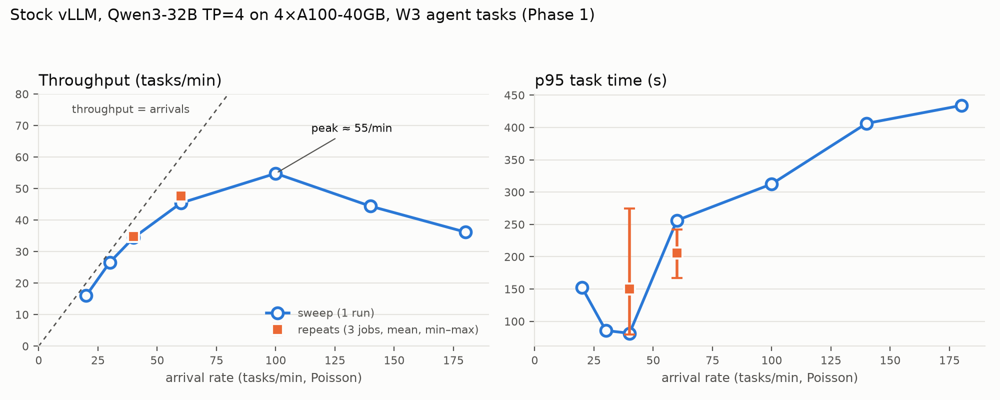

# Phase 1: naive baseline (PLAN §2j-P1)

**System:** stock vLLM 0.33, Qwen3-32B BF16, TP = 4 on one Perlmutter node (4 × A100-SXM4-40GB), FCFS, prefix caching on, no gateway, no speculation. Agent `agent-32b-v1` direct to vLLM on W3 (`w3_mix`: ~49% TPC-DS SF10, ~25% each TPC-H SF10 / SF100). Tag `system-32b-base`.
**KV pool:** 305,328 tokens (vLLM). **Open-loop cells:** Poisson, 60 s warm-up, 300 s measured window, 180 s drain cap; unfinished tasks count at their elapsed time.
**Jobs:**
- sweep: 61374027 / 61374028 / 61374963 / 61374964 (debug QOS, one part each, seed 0);
- repeats: 61395033 / 61395034 / 61395035 (seeds 0 / 1 / 2, in parallel).

**GPU cost:** sweep 1.53 node-h, repeats 1.75 node-h.

## Load curve

| level | p50 s | p95 s | throughput /min | unfinished | accuracy | LLM / DB / DB-queue share |
|---|---|---|---|---|---|---|
| c = 1 (30 tasks) | 11.6 [11.1–12.1] | 40.8 [21.3–76.6] | — | — | 21.1% | 88% / 7% / 4% |
| c = 4 (60 tasks) | 13.3 [12.4–14.5] | 41.2 [30.6–51.2] | — | — | 19.4% | 81% / 15% / 4% |
| **R\* = 40/min** | 21.6 [20.5–23.2] | 150 [79–275] | 34.7 [34.0–35.6] | 8.7 [1–21] | 24.8% | 74% / 24% / 2% |
| **R_o = 60/min** | 41.5 [28.1–50.6] | 206 [167–242] | 47.6 [46.0–48.8] | 8.3 [4–17] | 21.7% | 75% / 20% / 4% |

Repeats: mean [min–max] over the 3 jobs. The sweep cells (single runs) are in `p1_sweep.json`:
- 20 / 30 / 40 / 60 / 100 / 140 / 180 per min give throughput 16.0 / 26.6 / 34.4 / 45.4 / **54.8** / 44.4 / 36.2.
- p95: 152 / 86 / 82 / 256 / 313 / 406 / 434 s.

## What limits it

- **GPU compute, not KV memory, below ~100/min.** At R\* and R_o:
  - vLLM has 10–20 requests running and 0 waiting;
  - KV peaks at 25% / 43% of the pool;
  - no preemptions.
- **KV fills only past capacity.** At 100/min it reaches 85%; at 140–180/min it is at 100%, with requests waiting (22 / 155) and evictions.
- **Peak capacity ≈ 55 tasks/min.** Past it, stock throughput falls 34% (54.8 → 36.2 from 100 to 180/min). The cause is not KV thrashing: prefix hit stays 93–95% at every rate.
- **A load-independent tail.** Even at 20/min, 1–3 tasks per cell exceed warm-up + window + drain:
  - **repeated 60 s SQL timeouts on SF100** (h18: 5–6 timeouts, 300–380 s of DB time in one task);
  - **runaway generation** (t04: 15 turns, 7–10k output tokens).
- **The database is a real share of task time on W3.** Query time is 24% at R\* (7% at c = 1). On 8B/BIRD it was 3.6%.

## Prefix-cache misses (share of uncached prompt tokens)

| level | prefix hit | new (tool output, nudges) | re-render of previous reply | evicted proper | cold (turn 1) |
|---|---|---|---|---|---|
| c = 1 | 92.6% | 57% | 23% | 0% | 17% |
| c = 4 | 93.2% | 66% | 22% | 0% | 10% |
| 40/min | 93.8% | 66% | 27% | 0% | 6% |
| 60/min | 94.7% | 64% | 29% | 0.1% | 6% |
| 100 / 140 / 180 (sweep) | 93–95% | 46–62% | 6–18% | 12% / 32% / 35% | 5–7% |

**Re-render:**
- The cache hit for turn n never covers turn n−1's reply: 0 of 104 smoke turns.
- The chat template re-renders the history, so every turn re-prefills the previous reply.
- That is **22–29%** of all uncached prompt tokens at normal load.

**Evicted proper:** true eviction of earlier conversation appears only at ≥ 100/min.

## Pre-registered predictions (PLAN §2j-P1)

| | prediction | observed | verdict |
|---|---|---|---|
| P1-a | c = 1 p50 9–14 s; c = 4 p50 ≤ 1.15 × c = 1 | 11.6 s; 1.147× | **MET** |
| P1-b | R\* = 140 or 180/min, prefill-bound | no rate met the ceiling rule; peak capacity ≈ 55/min (Aryan set R\* = 40) | **NOT MET** |
| P1-c | at R_o: throughput ≤ 0.8 × R\*'s, p95 ≥ 3×, hit −15 pts, evicted largest, preemptions > 0 | throughput 1.37× (60/min is still below capacity), p95 1.37×, hit +0.9 pts, "new" largest, 0 preemptions | **NOT MET** (collapse appears only at 140–180/min) |
| P1-d | at R\*: LLM ≥ 75%, DB ≤ 15%, DB queue ≤ 5% | 74% / 24% / 2.3% | **NOT MET** (DB queue part met) |
| P1-e | logging overhead ≤ 2% | 0.03% (861.7 vs 862.0 out tok/s, same node) | **MET** |
| P1-f | KV per task 2.5–4k, K = 75–120 | estimator: 2.05k [1.06–2.55k], K = 175 [119–288]; noisy, because max in-flight tasks includes tasks waiting on the DB | **NOT MET** (and the estimator is unreliable here) |

## Instrumentation notes

- `step_ms` from vLLM's iteration details is scheduling + launch time under async scheduling (~33 ms at a point where vLLM's own throughput log implies ~100 ms per step). Use token counts and vLLM's throughput log, not `step_ms`, for GPU time.
- Logging (step log + iteration details + KV eviction metrics) costs nothing measurable.

## Implications for Phase 2 (for the A(a) pre-registration; not a result)

- **A(a), whole-task admission from the KV model.** K from the pool is ≥ 100 tasks, but KV is not the limit below ~100/min, so admission cannot raise throughput at R_o = 60. Its effect should show where stock collapses (140–180/min: 44 → 36/min vs ~55 peak).
- **The tail matters.** It is what drives p95 at R\*: SF100 timeouts and runaway generation. Those are the targets of B (forced final answer / goodput) and D (query scheduling), not of KV mechanisms.
- **Re-render prefill is a quarter of all uncached prefill.** C (prefill budget) and E work on it, and a prompt-side fix (caching the rendered reply) is possible.
